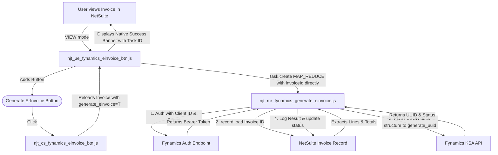

# Fynamics KSA E-Invoicing Integration (ZATCA)

This folder contains the complete SuiteScript 2.1 integration suite for authenticating with Fynamics and generating compliant E-Invoices (`generate_uuid`) directly from NetSuite Invoice records.

---

## 1. Solution Architecture (Direct User Event Trigger)



---

## 2. File Directory

| File Name | Script Type | Description |
| :--- | :--- | :--- |
| [`njt_ue_fynamics_einvoice_btn.js`](file:///c:/Users/EDWIN/Documents/Nija%20Projects/nija-projects/src/FileCabinet/SuiteScripts/Nija-projects-workspace/src/FileCabinet/SuiteScripts/Fynamics%20Integration/njt_ue_fynamics_einvoice_btn.js) | User Event (`beforeLoad`) | Injects the **Generate E-Invoice** button on Invoice records in `VIEW` mode, and executes `task.create` directly when triggered. |
| [`njt_cs_fynamics_einvoice_btn.js`](file:///c:/Users/EDWIN/Documents/Nija%20Projects/nija-projects/src/FileCabinet/SuiteScripts/Nija-projects-workspace/src/FileCabinet/SuiteScripts/Fynamics%20Integration/njt_cs_fynamics_einvoice_btn.js) | Client Script | Confirms user action and reloads the invoice with `generate_einvoice=T` to invoke the User Event trigger. |
| [`njt_mr_fynamics_generate_einvoice.js`](file:///c:/Users/EDWIN/Documents/Nija%20Projects/nija-projects/src/FileCabinet/SuiteScripts/Nija-projects-workspace/src/FileCabinet/SuiteScripts/Fynamics%20Integration/njt_mr_fynamics_generate_einvoice.js) | Map/Reduce | Authenticates, loads Invoice record, maps into Fynamics KSA `docs` JSON schema, and posts to `generate_uuid`. |
| [`njt_mr_fynamics_auth_token.js`](file:///c:/Users/EDWIN/Documents/Nija%20Projects/nija-projects/src/FileCabinet/SuiteScripts/Nija-projects-workspace/src/FileCabinet/SuiteScripts/Fynamics%20Integration/njt_mr_fynamics_auth_token.js) | Map/Reduce | Standalone OAuth 2.0 authentication verification script. |
| [`POSTMAN_TESTING_GUIDE.md`](file:///c:/Users/EDWIN/Documents/Nija%20Projects/nija-projects/src/FileCabinet/SuiteScripts/Nija-projects-workspace/src/FileCabinet/SuiteScripts/Fynamics%20Integration/POSTMAN_TESTING_GUIDE.md) | Guide | Full guide with copy-paste request parameters and headers. |
| [`Fynamics_EInvoice_Postman_Collection.json`](file:///c:/Users/EDWIN/Documents/Nija%20Projects/nija-projects/src/FileCabinet/SuiteScripts/Nija-projects-workspace/src/FileCabinet/SuiteScripts/Fynamics%20Integration/Fynamics_EInvoice_Postman_Collection.json) | Postman Collection | Importable Postman collection for 1-click testing. |

---

## 3. E-Invoice Endpoint & Request Format

* **Endpoint**: `https://sandbox-ksa.fynamicstax.com/api/partner/ksaapi/generate_uuid`
* **Headers**:
  - `accept_language`: `en`
  - `Content-Type`: `application/json`
  - `Authorization`: `Bearer <access_token>`
* **Body**: Contains the complete `docs` structure with `invoice`, `supplierparty`, `customerparty`, `invoice_level_charges`, `invoiceadditionaldocument`, `item`, `payment_type`, `billing_reference`, and `prepayment_details`.

---

## 4. NetSuite Deployment Steps (Only 2 Scripts to Deploy)

### Step 1: Deploy the Map/Reduce Script
1. Go to **Customization > Scripting > Scripts > New**.
2. Select [`njt_mr_fynamics_generate_einvoice.js`](file:///c:/Users/EDWIN/Documents/Nija%20Projects/nija-projects/src/FileCabinet/SuiteScripts/Nija-projects-workspace/src/FileCabinet/SuiteScripts/Fynamics%20Integration/njt_mr_fynamics_generate_einvoice.js).
3. Script ID: `customscript_njt_mr_fynamics_einvoice`.
4. Deploy Script:
   - Deployment ID: `customdeploy_njt_mr_fynamics_einvoice`.
   - Status: `Testing` or `Not Scheduled`.
   - Script Parameter: `custscript_fynamics_invoice_id` (Free-form Text).

### Step 2: Deploy the User Event Script
1. Go to **Customization > Scripting > Scripts > New**.
2. Select [`njt_ue_fynamics_einvoice_btn.js`](file:///c:/Users/EDWIN/Documents/Nija%20Projects/nija-projects/src/FileCabinet/SuiteScripts/Nija-projects-workspace/src/FileCabinet/SuiteScripts/Fynamics%20Integration/njt_ue_fynamics_einvoice_btn.js).
3. Script ID: `customscript_njt_ue_fynamics_btn`.
4. Deploy on Record Type: **Invoice**.
5. Event: `beforeLoad`. Status: `Testing` or `Released`.

---

## 5. Invoice Checkbox & Edit Locking Enhancement

To ensure ZATCA clearance integrity and avoid re-generation or accidental modifications to submitted invoices:
* **Checkbox Field on Invoice**:
  - Field ID: `custbody_fynamics_einvoice_generated` (Type: `Check Box`).
  - Fallback Field IDs supported: `custbody_einvoice_generated`, `custbody_fynamics_triggered`.
* **Behavior**:
  1. When **Generate E-Invoice** is clicked:
     - The background Map/Reduce task is submitted.
     - The checkbox (`custbody_fynamics_einvoice_generated`) is automatically checked (`true`) on the invoice.
  2. Once the checkbox is checked (or status is `CLEARED`):
     - The **Generate E-Invoice** button is permanently hidden.
     - The standard NetSuite **Edit** button is removed from the form (`form.removeButton({ id: 'edit' })`).
     - Direct editing via URL (`&e=T`) is blocked in `beforeLoad`.

---

## 6. QR Code Image File Cabinet Storage & PDF Template Usage

When an invoice is cleared, the Map/Reduce script automatically converts the ZATCA Base64 string into a scannable 2D QR Code image using a pure JavaScript library ([`njt_lib_qrcode.js`](file:///c:/Users/EDWIN/Documents/Nija%20Projects/nija-projects/src/FileCabinet/SuiteScripts/Nija-projects-workspace/src/FileCabinet/SuiteScripts/Fynamics%20Integration/njt_lib_qrcode.js)) with **zero external HTTP requests**.

### Automatic File Cabinet Storage
* **Folder**: Auto-finds or creates a folder named **`ZATCA QR Codes`** in the NetSuite File Cabinet (configurable via `CONFIG.QR_FOLDER_ID`).
* **Image Format**: Crisp, lossless 2D QR code (`.gif`, 316x316 px), set to `isOnline = true`.
* **Invoice Record Custom Fields Updated**:
  - `custbody_fynamics_qr_image` (Type: `Image` or `File`): Stores the internal File ID.
  - `custbody_fynamics_qr_url` (Type: `URL` or `Free-form Text`): Stores the file download/display URL.
  - `custbody_fynamics_qr_code` (Type: `Long Text`): Stores the raw ZATCA Base64 TLV string.

### How to Display in NetSuite Invoice PDF (Advanced PDF/HTML Template)

You can use either of the following in your Advanced PDF/HTML template:

**Option A (Using the File Cabinet Image Field - Recommended):**
```xml
<#if record.custbody_fynamics_qr_image?has_content>
    
</#if>
```

**Option B (Using the File URL Field):**
```xml
<#if record.custbody_fynamics_qr_url?has_content>
    
</#if>
```

**Option C (Using NetSuite's Native BFO Barcode Tag directly with Base64 text):**
```xml
<#if record.custbody_fynamics_qr_code?has_content>
    <barcode codetype="qrcode" showtext="false" value="${record.custbody_fynamics_qr_code}" width="120px" height="120px"/>
</#if>
```

---

## 7. Live Progress Loading Popup & Automatic Completion Reload

When the user clicks the **Generate E-Invoice** button on an Invoice:
1. **Instant Visual Feedback**: A modern, animated loading modal overlay immediately covers the screen with backdrop blur and spinner.
2. **Background Map/Reduce Polling**: The client script periodically polls the invoice fields via `N/search.lookupFields` (every 2.5 seconds) to track completion.
3. **Automatic Screen Refresh**:
   - Once the Map/Reduce script clears the invoice and sets `custbody_fynamics_einvoice_status = 'CLEARED'`, the modal turns into a green success indicator.
   - After a brief 1.5-second pause, the page automatically reloads, showing the updated invoice with the QR code and hiding the buttons.
4. **Error & Timeout Handling**: If clearance is rejected or encounters an error, the modal displays the exact error message and provides a "Close & Refresh" button. A 3-minute safety timeout prevents infinite spinning.

