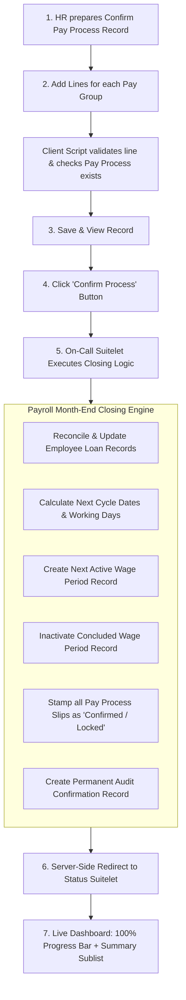

# Confirm Pay Process (SuiteScript 2.1)
## Comprehensive Technical & Functional Documentation

---

## 1. Executive Summary & Business Purpose

In HRMS (Human Resource Management System) and Enterprise Payroll operations, the **Confirm Pay Process** serves as the **official month-end payroll closing and rollover engine**.

Before salaries are locked for disbursement, payroll calculations (gross earnings, deductions, overtime, loans, unpaid leaves) are staged in a draft state. Once reviewed and approved by the HR / Finance management, the payroll batch must be **Officially Confirmed**. 

### Primary Business Objectives:
1. **Financial Freezing**: Locks the current month's payroll slips (`customrecord_hris_pay_process`) so that figures cannot be altered after approval.
2. **Loan & Advance Reconciliation**: Accurately credits employee loan repayments (EMIs) deducted during the month, reduces outstanding balances, and schedules the upcoming month's installment.
3. **Cycle Rollover**: Inactivates the concluded wage period and automatically generates the **next wage period cycle** (calculating start date, end date, weekend/weekly off counts, and total working days).
4. **Audit Trail & Governance**: Creates a permanent historical record (`customrecord_hris_confirm_process_record`) showing who closed which pay group and when.
5. **Real-time Monitoring**: Provides the HR administrator with an interactive visual dashboard displaying a real-time progress bar (0% to 100%) and a verification table.

---

## 2. Functional Workflow (Business Perspective)



### Step 1: Preparation & Staging
1. The HR administrator opens the **Confirm Pay Process** form (`customrecord_hris_confirm_pay_process`).
2. The user adds lines in the child sublist for each **Pay Group** to be closed (e.g., Executive Staff, Factory Workers, Dubai Office).
3. As soon as a Pay Group and Process Type (Regular Payroll = `1`) are chosen, the client script auto-populates the active wage period start date, end date, wage month, and wage year.
4. The line validation ensures:
   - The confirmation checkbox is checked.
   - No duplicate Pay Groups exist on the same confirmation record.
   - A completed **Pay Process** actually exists for that Pay Group, Month, and Year (preventing closing an un-run payroll).

### Step 2: Triggering the Closure
1. The user saves the record and views it in **VIEW mode**.
2. A custom button labeled **"Confirm Process"** appears on the top bar.
3. Clicking this button triggers the client script to inspect which Pay Groups were checked and launches the backend **On-Call Suitelet** in a dedicated window.

### Step 3: Automated Payroll Closure Logic
The On-Call Suitelet executes four sequential business operations:
1. **Loan & EMI Processing**:
   - Identifies all salary slips with loan repayments.
   - Updates the employee's master Loan Record: adds to **Paid Amount** and deducts from **Outstanding Balance**.
   - If an outstanding balance remains, it appends a new installment line scheduled for the upcoming month.
2. **Next Wage Period Generation**:
   - Determines pay cycle type (Full-Month cycle: 21st to 20th; or Half-Month cycle: 1st-15th & 16th-month end).
   - Advances month by +1 (handling December-to-January and leap-year transitions).
   - Looks up the Pay Group's weekly off configuration (e.g., Friday/Saturday or Saturday/Sunday).
   - Calculates the net **Wage Cycle Days** (Total calendar days minus weekends).
   - Creates the **Next Active Wage Period Detail** record.
3. **Locking Past Period**:
   - Sets the concluded wage period to **Inactive** (`isinactive = true`).
   - Flags all associated employee pay process slips with `custrecord_hris_pay_proc_confirm_process = true` (freezing them permanently).
4. **Audit Logging**:
   - Creates an entry in `customrecord_hris_confirm_process_record` linking to the parent batch ID.

### Step 4: Status Dashboard Handoff
- The backend engine redirects the user to the **Status Suitelet**.
- The page renders a visual progress bar (e.g., `100.00% Completed`) and a sublist detailing each confirmed Pay Group, year, cycle start date, and cycle end date.

---

## 3. Technical Architecture & SuiteScript Implementation

### 3.1 Script Inventory & Roles

| Script File | SuiteScript Type | Entry Points / Triggers | Primary Responsibility |
| :--- | :--- | :--- | :--- |
| `hris_Confirm_PayProcess_cs_2.1.js` | Client Script (2.1) | `fieldChanged`, `validateLine` | Sourcing wage period dates onto child lines; validating Pay Group uniqueness and prior pay process existence. |
| `hris_Confirm_PayProcess_ue_2.1.js` | User Event (2.1) | `beforeLoad` (VIEW) | Injects the **"Confirm Process"** button and links the button handler module. |
| `hris_Conf_Process_Oncall_cs_2.1.js` | Client Script (2.1) | `callConfirmPayProcess` | Reads checked child lines from the parent record, counts selections, resolves On-Call Suitelet URL, and opens it. |
| `hris_Conf_Process_Oncall_sl_2.1.js` | Suitelet (2.1) | `onRequest` (GET) | **The Core Engine**: Executes loan allocations, wage generation, wage inactivation, salary slip locking, audit creation, and redirects via `N/redirect`. |
| `hris_CallConfirmPayProcessForm_cs_2.1.js`| Client Script (2.1) | `pageInit` | Fallback client-side redirector if server-side redirect encounters an exception. |
| `hris_ConfirmPayProcessStatus_sl_2.1.js` | Suitelet (2.1) | `onRequest` (GET) | Renders the HTML/CSS **Progress Bar**, queries audit confirmation records, and populates the results sublist. |
| `hris_SetCnfrmCompleteStatus_cs_2.1.js` | Client Script (2.1) | `pageInit`, `saveRecord_SetConfrimCompleteStatus` | Manages 10-second auto-refresh timer until 100% completion; handles manual "Refresh" button click. |

---

### 3.2 Technical Interaction Sequence

```mermaid
sequenceDiagram
    autonumber
    actor Admin as Payroll Admin
    participant CPR as Confirm Pay Record (UI)
    participant CS_Rec as hris_Confirm_PayProcess_cs_2.1.js
    participant UE as hris_Confirm_PayProcess_ue_2.1.js
    participant CS_Btn as hris_Conf_Process_Oncall_cs_2.1.js
    participant SL_Core as hris_Conf_Process_Oncall_sl_2.1.js
    participant DB as NetSuite Database
    participant SL_Status as hris_ConfirmPayProcessStatus_sl_2.1.js
    participant CS_Status as hris_SetCnfrmCompleteStatus_cs_2.1.js

    Admin->>CPR: Opens Form & Adds Pay Group Lines
    CPR->>CS_Rec: validateLine(context)
    CS_Rec->>DB: Search pay process existence
    DB-->>CS_Rec: Valid
    Admin->>CPR: Saves Record (ID: 105)
    
    Admin->>CPR: Views Record 105
    CPR->>UE: beforeLoad(VIEW)
    UE->>CPR: Injects "Confirm Process" button
    
    Admin->>CPR: Clicks "Confirm Process"
    CPR->>CS_Btn: callConfirmPayProcess(105)
    CS_Btn->>CS_Btn: Reads sublist & filters checked lines
    CS_Btn->>SL_Core: Opens in _blank with params (processid=105, count=1)
    
    Note over SL_Core: Core Processing Begins
    SL_Core->>DB: Load record 105 & read lines
    SL_Core->>DB: handleLoanAllocations() -> Updates Loan Application
    SL_Core->>DB: getWageDetails() -> Finds current active wage period
    SL_Core->>DB: createNextWagePeriod_FullMonth() -> Inserts new Wage Period
    SL_Core->>DB: inactivateCurrentWage() -> Sets old Wage Period isinactive=T
    SL_Core->>DB: createConfirmProcessRecord() -> Inserts Audit Log
    SL_Core->>DB: markPayProcessConfirmed() -> Stamps salary slips
    
    Note over SL_Core,SL_Status: Server-Side Redirect
    SL_Core->>SL_Status: redirect.toSuitelet(sts_sl, { parentid: 105, count: 1 })
    
    SL_Status->>DB: Search customrecord_hris_confirm_process_record (parentid=105)
    DB-->>SL_Status: Returns confirmed record
    SL_Status->>Admin: Renders Progress Bar (100%) & Confirmed Sublist
    SL_Status->>CS_Status: pageInit (checks percentage; stops timer if 100%)
```

---

## 4. Detailed Code Structure & Logic per Component

### 4.1 Record Validation & Date Sourcing (`hris_Confirm_PayProcess_cs_2.1.js`)
* **`fieldChanged`**:
  - Triggers when `custrecord_hris_confirm_proc_paygroup` or `custrecord_hris_confirm_proc_proctype` changes.
  - Queries active `customrecord_hris_wage_period_details` where `custrecord_hris_pay_group == paygrpID` and `isinactive == 'F'`.
  - Automatically writes `custrecord_hris_confirm_proc_from_wage`, `custrecord_hris_confirm_proc_to_wage`, `custrecord_hris_confirm_proc_pay_month`, and `custrecord_hris_confirm_proc_pay_year`.
* **`validateLine`**:
  - Validates that `custrecord_hris_confirm_proc_check` is checked (`true` or `'T'`).
  - Verifies no duplicate Pay Group line exists on the sublist.
  - Queries `customrecord_hris_pay_process` to confirm a payroll calculation run exists for that Pay Group, Month, and Year.

---

### 4.2 Button Injection (`hris_Confirm_PayProcess_ue_2.1.js`)
* Executes on `beforeLoad` when `scriptContext.type === scriptContext.UserEventType.VIEW`.
* Binds client script module:
  ```javascript
  form.clientScriptModulePath = './hris_Conf_Process_Oncall_cs_2.1.js';
  ```
* Adds the confirmation action button:
  ```javascript
  form.addButton({
      id: 'custpage_ConfButton',
      label: 'Confirm Process',
      functionName: `callConfirmPayProcess(${confirmProcessId})`
  });
  ```

---

### 4.3 Client Dispatcher (`hris_Conf_Process_Oncall_cs_2.1.js`)
* Loads the parent `customrecord_hris_confirm_pay_process`.
* Loops through `recmachcustrecord_hris_confirm_proc_process_gro` sublist.
* Filters lines where `custrecord_hris_confirm_proc_check === true`.
* Collects Pay Group IDs into an array and computes `trueCount`.
* Resolves `customscript_hris_cnfrmpayproce_oncal_sl` and launches `window.open(suiteletUrl, '_blank')`.
* **Global Scope Exposure**:
  ```javascript
  window.callConfirmPayProcess = callConfirmPayProcess;
  ```

---

### 4.4 The Closing Engine (`hris_Conf_Process_Oncall_sl_2.1.js`)
* Entry point: `onRequest` (HTTP GET).
* Reads parameters: `custscript_processid`, `custscript_truecount`, `custscript_pagegroup`.
* Core sub-routines:
  1. **`handleLoanAllocations(paygrpID, Pay_Month, Payyear, To_Wage)`**:
     - Searches `customrecord_hris_pay_process` where `custrecord_hris_pay_proc_loan_reference` is not null and `confirm_process == 'F'`.
     - Loads dynamic `customrecord_hris_empchange_loan_applicn`.
     - Updates `custrecord_hris_loan_paid_amount` and `custrecord_hris_loan_outstanding_amount`.
     - If balance remains, adds a line in `recmachcustrecord_hris_loan_alloc_link` sublist for the next installment.
  2. **`getWageDetails(paygrpID, From_wage, To_Wage, Pay_Month)`**:
     - Searches `customrecord_hris_wage_period_details` using `'anyof'` on `custrecord_hris_pay_group` and `custrecord_hris_month`.
     - Uses local date formatting (`formatForSearch`) to match start and end dates.
     - Includes automatic fallback to match by `pay_group + month + isinactive=F` if exact dates have formatting variances.
  3. **`createNextWagePeriod_FullMonth(...)` / `createNextWagePeriod_HalfMonth(...)`**:
     - Computes next month (`wage_Month + 1`) and year (rolling over December to January).
     - Resolves date range using `getdate()` (standard cycle: 21st to 20th; Pay Group 202: 16th to 15th).
     - Queries Pay Group master for weekly off days (`custrecord_hris_weekly_off_s`).
     - Calculates weekend count (`getWeekend`) and net wage cycle days (`tot_days - weekend_count`).
     - Inserts the new active `customrecord_hris_wage_period_details` record.
  4. **`inactivateCurrentWageAndDeleteConfirmLine(...)`**:
     - Submits `isinactive: true` on the old wage period.
     - Deletes the child line from the queue sublist.
  5. **`createConfirmProcessRecord(...)`**:
     - Creates the audit tracking record in `customrecord_hris_confirm_process_record` with `custrecord_hris_cnfrm_proce_rec_parent_p = String(ConfirmProcessid)`.
  6. **`markPayProcessConfirmed(...)`**:
     - Queries salary slips with `custrecord_hris_pay_proc_confirm_process == false`.
     - Submits `custrecord_hris_pay_proc_confirm_process: true` while monitoring script governance (`remainingUsage > 100`).
  7. **Server-Side Redirection**:
     - Directly issues HTTP redirect via `N/redirect`:
       ```javascript
       redirect.toSuitelet({
           scriptId: 'customscript_hris_cnfrmpayprocess_sts_sl',
           deploymentId: 'customdeploy_hris_cnfrmpayprocess_sts_sl',
           parameters: {
               custscript_truecount: trueCount,
               custscript_paygroup: a_PageGroup,
               custscript_parentid: ConfirmProcessid
           }
       });
       ```

---

### 4.5 Status Suitelet & UI Dashboard (`hris_ConfirmPayProcessStatus_sl_2.1.js`)
* Entry point: `onRequest` (HTTP GET).
* Reads `custscript_parentid`, `custscript_paygroup`, `custscript_truecount`.
* Queries `customrecord_hris_confirm_process_record` using:
  ```javascript
  filters.push(['custrecord_hris_cnfrm_proce_rec_parent_p', 'is', String(i_ParentProcesssID)]);
  ```
* Calculates completion percentage:
  $$\text{Progress \%} = \frac{\text{Processed Count}}{\text{Total Expected Count}} \times 100$$
* Injects inline HTML/CSS progress bar (`#myProgress`, `#myBar`, `#label`).
* Populates `custpage_payprocesssublist` with confirmed Pay Groups, year, start date, and end date.
* Adds a manual **"Refresh"** button.

---

### 4.6 Auto-Refresh Client Script (`hris_SetCnfrmCompleteStatus_cs_2.1.js`)
* Attached to the Status Suitelet page.
* **`pageInit`**:
  - Checks if progress is below 100% (`i_Refresh < 100`).
  - Sets a 10-second timer (`setTimeout 10000ms`) to re-trigger `saveRecord_SetConfrimCompleteStatus()`, refreshing the view until all records reach 100%.
  - When 100% is reached, the timer stops automatically.
* Exposes `window.saveRecord_SetConfrimCompleteStatus` to global window scope for button clickability.

---

## 5. Data Model & Field Mapping Reference

### Custom Record Summary

| Custom Record Script ID | Record Name | Role in Process |
| :--- | :--- | :--- |
| `customrecord_hris_confirm_pay_process` | Confirm Pay Process | Parent staging record where HR selects which Pay Groups to close. |
| `customrecord_hris_confirm_process` | Confirm Process Line | Child sublist lines (`recmachcustrecord_hris_confirm_proc_process_gro`). |
| `customrecord_hris_process_groupmaster` | Process Group Master | Pay Group configuration (Pay Frequency, Weekly Off days). |
| `customrecord_hris_wage_period_details` | Wage Period Details | Active wage period calendar cycles (dates, month, year, cycle days). |
| `customrecord_hris_pay_process` | Pay Process Slips | Individual employee salary calculation entries for the month. |
| `customrecord_hris_empchange_loan_applicn`| Loan Application | Employee loan master record tracking loan balance, EMIs, and installments. |
| `customrecord_hris_confirm_process_record`| Confirm Process Record | Permanent historical audit log proving confirmation completion. |

---

## 6. Key Technical Quirks & How They Were Resolved

1. **SuiteScript Logging Methods**:
   - `N/log` in SuiteScript 2.x supports `debug`, `audit`, `error`, and `emergency`. It **does not support `log.warn`**. All logging is implemented using `log.debug` and `log.error`.
2. **Field Types & Search Operators**:
   - `custrecord_hris_cnfrm_proce_rec_parent_p` is defined as a `TEXT` field in NetSuite metadata; search filters must use the `'is'` operator with string values.
   - `custrecord_hris_pay_group` and `custrecord_hris_month` in `customrecord_hris_wage_period_details` are `SELECT` (List/Record) fields; search filters must use the `'anyof'` operator with internal IDs or arrays.
3. **Local Date vs. UTC Shift**:
   - Using standard JavaScript `d.getUTCDate()` on dates loaded at local midnight causes a 1-day backward shift in timezones ahead of UTC (e.g., IST GMT+5:30, GST GMT+4:00). All date calculations strictly utilize local date components (`getDate()`, `getMonth()`, `getFullYear()`) and `N/format`.
4. **Server-Side Redirect (`N/redirect`)**:
   - Modern SuiteScript 2.1 replaces legacy SuiteScript 1.0 client-side redirection (`form.clientScriptModulePath` + `window.open`) with direct HTTP 302 redirection via `redirect.toSuitelet`, eliminating popup blockers and blank transition screens.
5. **Button Function Scoping**:
   - Custom NetSuite buttons invoking `functionName: 'myFunc()'` require `myFunc` to be attached to the global `window` object in SuiteScript 2.x Client Scripts (`window.callConfirmPayProcess`, `window.saveRecord_SetConfrimCompleteStatus`).

---

## 7. Deployment & Verification Checklist

- [x] **Client Script attached to Record**: Ensure `hris_Confirm_PayProcess_cs_2.1.js` is deployed on `customrecord_hris_confirm_pay_process`.
- [x] **User Event Script deployed**: Ensure `hris_Confirm_PayProcess_ue_2.1.js` is deployed on `customrecord_hris_confirm_pay_process` in **VIEW** mode.
- [x] **On-Call Suitelet deployment**: 
  - Script ID: `customscript_hris_cnfrmpayproce_oncal_sl`
  - Deployment ID: `customdeploy_hris_cnfrmpayproce_oncal_sl`
  - Status: **Released**, Audience: **All Roles**.
- [x] **Status Suitelet deployment**: 
  - Script ID: `customscript_hris_cnfrmpayprocess_sts_sl`
  - Deployment ID: `customdeploy_hris_cnfrmpayprocess_sts_sl`
  - Status: **Released**, Audience: **All Roles**.
- [x] **Client Scripts in File Cabinet**: Ensure all `.js` files are saved in the same directory (`FileCabinet/SuiteScripts/Pure SB Confirm Pay process/Confirm Pay Process V2.1/`) so relative module references resolve seamlessly.
